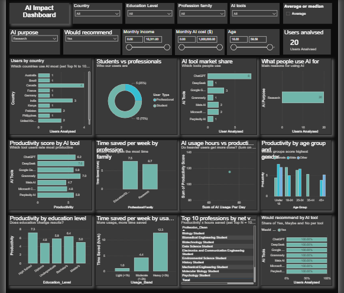

# Al-Impact-Dashboard

### 1. Project Title / Headline
**AI Impact Dashboard**

### 2. Short Description / Purpose
Developed an interactive Power BI dashboard to analyze the impact of Artificial Intelligence (AI) on productivity, time savings, and professional workflows. The dashboard explores AI adoption across different countries, education levels, age groups, and professions. It compares popular AI tools, measures daily AI usage, evaluates productivity scores, tracks weekly time savings, and analyzes user satisfaction and recommendation patterns.

The dashboard helps users understand AI adoption trends and how different AI tools contribute to workplace productivity and efficiency.

### 3. Tech Stack
* **Power BI Desktop** - Dashboard development, data visualization, and interactive reporting.
* **DAX** - Calculated measures and KPIs, including total users, average AI usage, productivity score, and time saved.
* **CSV** - Dataset input and structured data.
* **Power BI** - Visualizations: Bar charts, donut charts, column charts, KPI cards, slicers, and tables.

### 4. Data Source
-Source: Kaggle
-Dataset Platform: Kaggle
-File Format: CSV (Comma-Separated Values)
-Usage: Data cleaning, exploratory data analysis, KPI development, and interactive Power BI dashboard creation.

### 5. Features / Highlights

## Business Problem
Many professionals use AI tools in their daily work, but their actual impact on productivity is not always clear. Businesses need to understand which AI tools are most useful and how much time they save. They also need to analyze AI usage, productivity, and user satisfaction across different professions and age groups. This dashboard helps identify these trends and supports better decision-making.

## Goal of the Dashboard
The main goal of this dashboard is to understand how AI tools affect people's productivity and daily work. It aims to identify the most popular AI tools, measure time saved, and compare productivity across different professions and age groups. It also helps analyze user satisfaction and AI adoption trends to provide meaningful insights for better decision-making.

## Walkthrough of Key Visuals
1. Users Analysed (KPI Card): Displays the total number of users included in the analysis.
2. Users by Country: Shows the distribution of AI users across different countries.
3. Students vs Professionals: A donut chart comparing AI usage among students and working professionals.
4. AI Tool Market Share: Highlights the popularity and usage of different AI tools such as ChatGPT, Gemini, and other platforms.
5. What People Use AI For: Shows the main purposes for which people use AI, such as research and other activities.
6. Productivity Score by AI Tool: Compares the productivity scores of different AI tools to identify which tools perform better.
7. Time Saved per Week by Profession: Shows how much time different professional groups save by using AI tools.
8. AI Usage Hours vs Productivity: A scatter chart that helps understand the relationship between daily AI usage and productivity scores.
9. Productivity by Age Group: Compares productivity scores across different age groups and genders.
10. Productivity by Education Level: Shows how productivity varies among users with different education levels.
11. Time Saved by AI Usage Band: Analyzes weekly time savings based on users' AI usage levels.
12. Top 10 Professions: Displays the leading professions based on the dashboard's selected net-value metric.
13. AI Tool Recommendation: Compares user recommendation percentages for different AI tools.

Interactive Filters: Country, Education Level, Profession Family, AI Tools, AI Purpose, Recommendation, Monthly Income, Monthly AI Cost, and Age help users explore the dashboard from different perspectives.

## Business Impact & Insights
* Helps businesses understand how AI tools are improving productivity and saving employees' time.
* Identifies the most popular AI tools and the main purposes for which people use them.
* Highlights differences in AI adoption and productivity across professions, age groups, and education levels.
* Helps identify which AI tools receive higher user satisfaction and recommendations.
* Provides useful insights into AI usage patterns to support better business decisions.
* Encourages organizations to choose suitable AI tools, improve work efficiency, and make better use of AI technology.

**Overall Impact:** The dashboard converts AI usage data into meaningful insights, helping businesses understand the value of AI in improving workplace productivity and efficiency.

### 6. Screenshots / Demos

